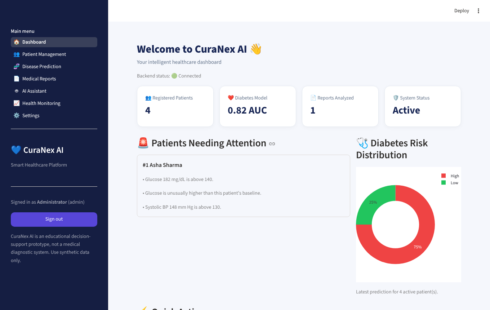
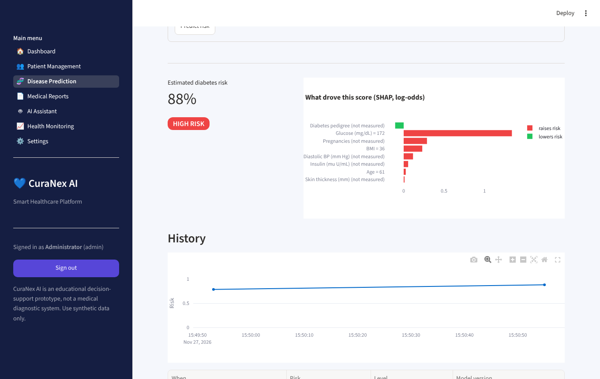
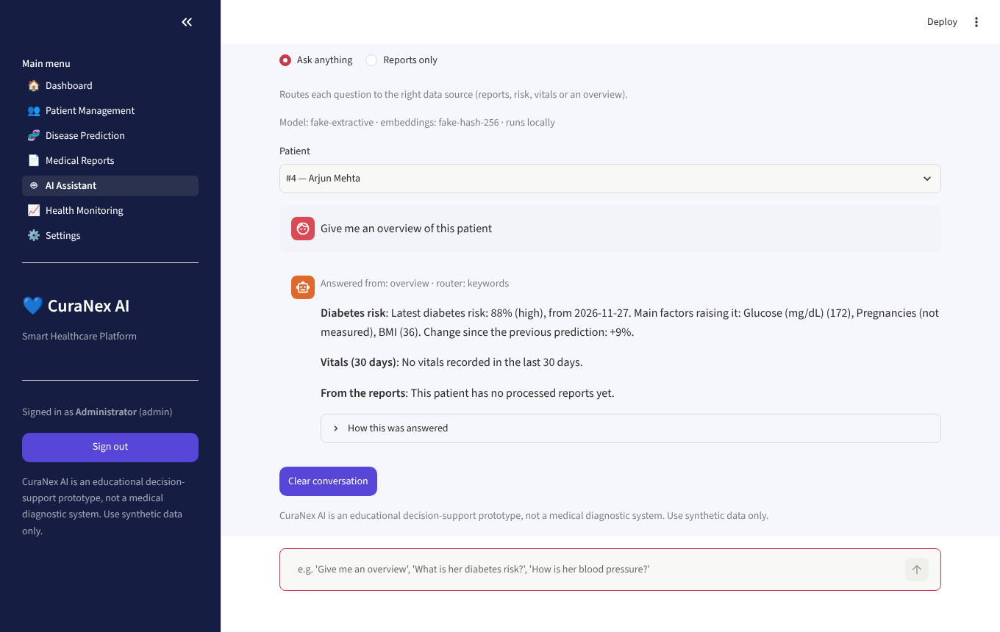
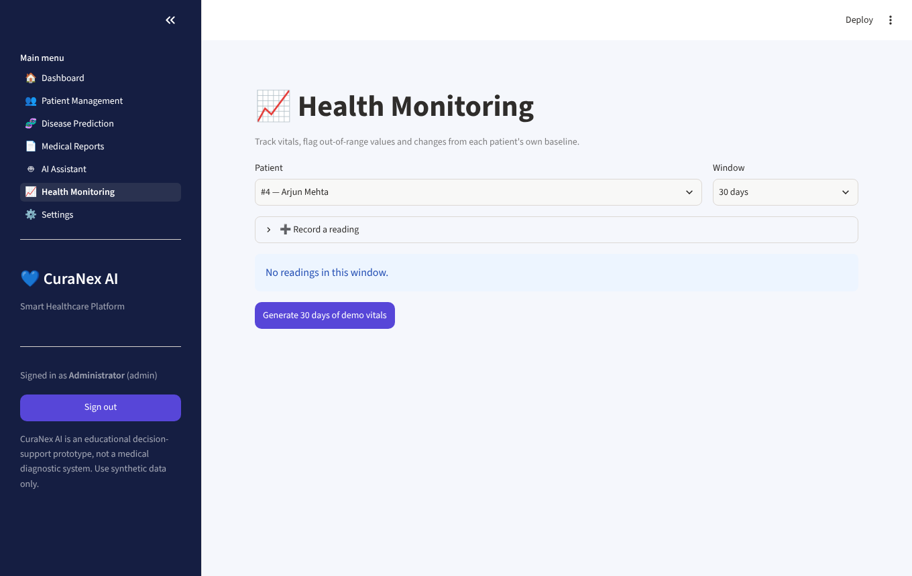

# CuraNex AI

CuraNex AI is a small healthcare decision-support app I built to learn how the pieces of a
"clinical AI" product fit together. You can register patients, estimate their diabetes risk
and see why the model scored them that way, upload lab reports and ask questions about them,
and keep an eye on vitals over time. Everything runs on your own machine, including the
language model.

> **Please read this first.** CuraNex AI is a portfolio and learning project. It is not a
> medical device and it does not diagnose anything. Only use synthetic or public,
> de-identified data, and never enter real patient information.



## What it can do

- **Manage patients.** Add, edit and archive patient records.
- **Estimate diabetes risk.** An XGBoost model trained on the Pima Indians Diabetes dataset
  gives a risk score, and a SHAP chart shows which inputs pushed the score up or down.
  Every prediction is saved, so you can watch how a patient's risk changes.
- **Read medical reports.** Upload a PDF or an image. CuraNex pulls the text out, and falls
  back to OCR when the file is a scan.
- **Answer questions about reports.** Ask something like "What was her last HbA1c?" and get
  an answer that cites the exact report excerpts it used.
- **Watch vitals.** Record glucose, blood pressure, heart rate, SpO2, temperature and weight.
  The app flags readings that are out of range, unusual for that specific patient, or
  trending the wrong way.
- **Ask anything.** One chat box routes your question to the right place: reports, risk,
  vitals, or a full overview of the patient.

| Risk prediction with explanation | "Ask anything" assistant |
|---|---|
|  |  |



## Quick start

The easiest way to try it is with Docker:

```bash
docker compose up --build
```

Then open http://localhost:8501 and sign in with the demo account `admin@curanex.local` /
`Curanex-demo-123`. The API and its interactive docs are at http://localhost:8000/docs.

That starts Postgres, the API and the UI. The AI assistant needs a local language model, so
to turn it on as well, run:

```bash
docker compose --profile llm up --build
```

This adds Ollama and downloads `llama3.1:8b` and `nomic-embed-text` the first time (a few GB,
and you'll want around 8 GB of RAM free). If you'd rather skip the download, set
`CURANEX_LLM_PROVIDER=fake` and the assistant will give simple extractive answers instead.

To change the demo login, set `CURANEX_ADMIN_EMAIL` and `CURANEX_ADMIN_PASSWORD` in `.env`
before the first start.

### Running without Docker

You'll need Python 3.13 (what CI uses) and, for scanned reports, the `tesseract` binary
(`brew install tesseract` or `apt install tesseract-ocr`).

```bash
python -m venv .venv && source .venv/bin/activate
pip install -r requirements-dev.txt
cp .env.example .env              # optional, the defaults use SQLite in ./data

alembic upgrade head              # create the database
uvicorn app.main:app --reload     # API on http://127.0.0.1:8000

# in a second terminal
python -m app.cli create-user --email you@example.com --name "Your Name" --role admin
cd frontend && streamlit run app.py   # UI on http://localhost:8501
```

For the assistant, install [Ollama](https://ollama.com) and run
`ollama pull llama3.1:8b && ollama pull nomic-embed-text`.

## How it's put together

```
Streamlit UI (frontend/) ──HTTP──► FastAPI (app/) ──► SQLAlchemy ──► SQLite (dev) / Postgres (Docker)
                                        │
                                        ├─ app/ml          diabetes risk model (XGBoost + SHAP)
                                        ├─ app/reports     PDF text extraction + Tesseract OCR
                                        ├─ app/rag         chunking, embeddings, retrieval, cited answers
                                        ├─ app/monitoring  vitals analysis
                                        ├─ app/agents      LangGraph router for "Ask anything"
                                        └─ Ollama          local LLM (optional)
```

The UI only talks to the API, and the API keeps business logic in `app/services/` so the
HTTP layer stays thin. Database changes go through Alembic migrations in `migrations/`.

<details>
<summary>Folder layout</summary>

```
app/
  main.py              FastAPI app
  core/                settings (env vars prefixed CURANEX_) and security helpers
  db/                  engine, session and ORM models
  schemas/             Pydantic request and response models
  services/            business logic, no HTTP
  api/routes/          HTTP endpoints
  ml/ reports/ rag/ monitoring/ agents/
migrations/            Alembic migrations
frontend/
  app.py               Streamlit entrypoint and navigation
  views/               one file per page
datasets/              training and evaluation data (see datasets/README.md)
models/                trained model and its metadata
docker/                Dockerfiles for the API and the UI
tests/                 pytest suite
```

</details>

## A closer look at each part

### Diabetes risk

The model lives in `models/diabetes/` as plain XGBoost JSON (no pickle files), next to a
`metadata.json` that records its version, settings, a hash of the training data and its
scores on held-out data. Right now that's a ROC AUC of 0.82 and a recall of 0.83.

A few things worth knowing:

- In the Pima data a zero for glucose, blood pressure, skin thickness, insulin or BMI really
  means "not measured", so the model treats those zeros as missing.
- Risk is shown as low (under 30%), moderate (30 to 60%) or high (60% and up).
- Each saved prediction keeps its inputs, the model version and the SHAP values, so you can
  always see exactly how an old score was produced.
- The training data only covers Pima women aged 21 and over, so don't read too much into
  scores for anyone outside that group.

To retrain (takes about 10 seconds):

```bash
python -m app.ml.train_diabetes
```

### Medical reports

You can upload PDF, PNG or JPEG files up to 10 MB. The app checks the file's actual contents
rather than trusting its extension, and stores it under a random name. PDF pages that have
real text are read directly with PyMuPDF. Scanned pages and images go through Tesseract OCR.

### The report assistant (RAG)

When you ask about a patient's reports, CuraNex:

1. splits each report into overlapping chunks of about 900 characters, keeping track of
   which page each chunk came from,
2. turns those chunks into embeddings with `nomic-embed-text` and stores them in the
   database (this happens the first time you ask, and again if you change embedding model),
3. finds the most relevant chunks for that patient using cosine similarity, and
4. asks `llama3.1:8b` to answer using only those chunks, citing them as `[1]`, `[2]` and so on.

The prompt tells the model not to diagnose, and to treat report text as data rather than
instructions, which guards against a report that tries to hijack the assistant. No report
text ever leaves your machine.

I deliberately didn't use a vector database here. Each patient only has a handful of
reports, so a few hundred vectors and numpy are plenty, and it's one less service to run.

There's a small evaluation set to check answer quality, including a prompt-injection
attempt and a question the reports can't answer:

```bash
CURANEX_LLM_PROVIDER=ollama python -m app.rag.evaluate --verbose
```

It reports how often the right excerpt was found, how often the answer was right, how often
it cited its sources, and whether the guardrails held. It's handy for tuning
`CURANEX_RAG_TOP_K` and `CURANEX_RAG_MIN_SCORE` or comparing models.

### Health monitoring

Each vital sign gets three separate checks:

- **Out of range:** the latest reading falls outside a general adult reference range.
- **Unusual for this patient:** the latest reading is far from the patient's own history
  (a robust z-score based on the median, needing at least 6 readings). This catches changes
  that are still technically "normal" but aren't normal for that person.
- **Trend:** how fast the value is rising or falling per 30 days, and how steady that trend is.

The dashboard lists every patient with an active alert. If you just want to see it in
action, the **Generate 30 days of demo vitals** button creates 30 days of synthetic readings, either
stable or worsening.

### "Ask anything"

This is a small LangGraph workflow:

```
route ──► reports | risk | vitals | overview ──► compose
```

The language model reads your question and picks one of the four routes. If it gives an
odd answer or isn't running, simple keyword rules take over. Questions about reports go to
the assistant above. Risk and vitals answers are filled in from stored data using fixed
templates, so the numbers can't be made up, and they keep working even when the language
model is down. Each answer has a "How this was answered" section showing the steps it took.

### Sign-in and roles

Everything except the health check and the login endpoint needs you to be signed in.
Passwords are hashed with Argon2 and sessions use JWTs that last 60 minutes. There are two
roles: clinicians can use every clinical feature, and admins can also manage users. When you
deactivate a user, their existing sessions stop working straight away.

Outside development mode the API refuses to start with the default or a weak
`CURANEX_JWT_SECRET`, so you can't accidentally ship the demo secret.

Because this is a demo, a few things a real product would need are left out: refresh tokens,
login rate limiting, password reset, per-patient access control and an audit log.

<details>
<summary>API endpoints</summary>

All endpoints are also listed with request and response schemas at `/docs`.

| Endpoint | What it does |
|---|---|
| `POST /auth/token` | Sign in (OAuth2 password flow, `username` is the email) |
| `GET /auth/me` | The signed-in user |
| `GET` / `POST /auth/users` | List or create users (admin) |
| `PATCH /auth/users/{id}` | Activate or deactivate a user (admin) |
| `GET /models/diabetes` | Model metadata and scores |
| `POST /patients/{id}/predictions/diabetes` | Score a patient and save the result |
| `GET /patients/{id}/predictions` | A patient's prediction history |
| `GET /predictions/summary` | Latest risk level across active patients |
| `POST /patients/{id}/reports` | Upload a report (multipart `file`) |
| `GET /patients/{id}/reports` | A patient's reports |
| `GET /reports/{id}` | Report details and extracted text |
| `GET /reports/{id}/file` | Download the original file |
| `GET /reports/count` | Number of processed reports |
| `GET /assistant/status` | Which models are configured and reachable |
| `POST /patients/{id}/assistant/index` | Index a patient's reports now |
| `POST /patients/{id}/assistant/ask` | Ask about a patient's reports |
| `POST /patients/{id}/agent/ask` | "Ask anything" |
| `POST /patients/{id}/vitals` | Record a reading |
| `GET /patients/{id}/vitals?days=` | List readings |
| `GET /patients/{id}/vitals/analysis?days=` | Flags, outliers, trends and alerts |
| `POST /patients/{id}/vitals/demo` | Generate synthetic history (`stable` or `worsening`) |
| `GET /monitoring/alerts` | Active patients with alerts |

</details>

## Development

```bash
pytest -q                                   # run the tests
ruff check . && ruff format --check .       # lint and formatting
alembic revision --autogenerate -m "..."    # after changing app/db/models.py
```

The tests use a fake language model, so they run offline and don't need Ollama. GitHub
Actions runs the linter, the tests, a migration up-and-down check and a Docker build on
every pull request.

## What's done and what could come next

All the planned pieces are in place: the foundation, diabetes prediction, report upload and
OCR, the report assistant, health monitoring, sign-in, and the "Ask anything" router.

Ideas for later:

- a second model, such as heart disease risk
- per-patient access control and an audit log
- running the assistant evaluation in CI against a real model
